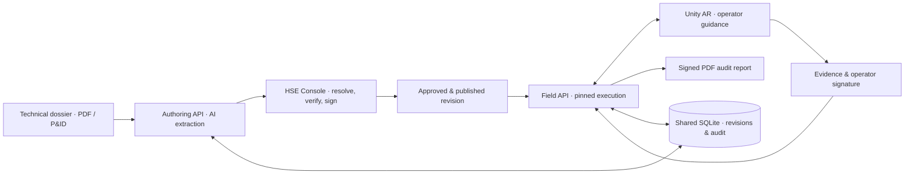
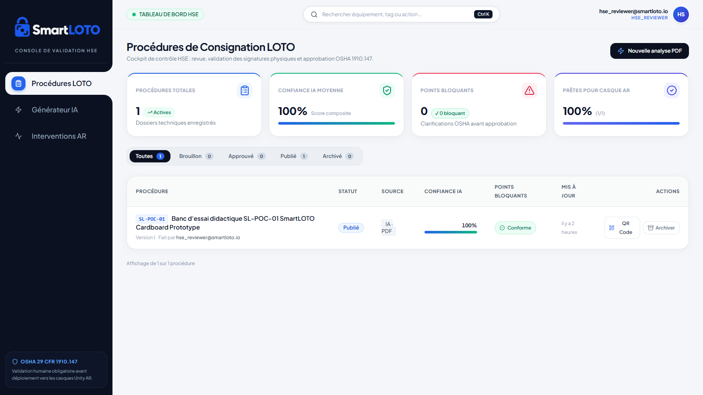
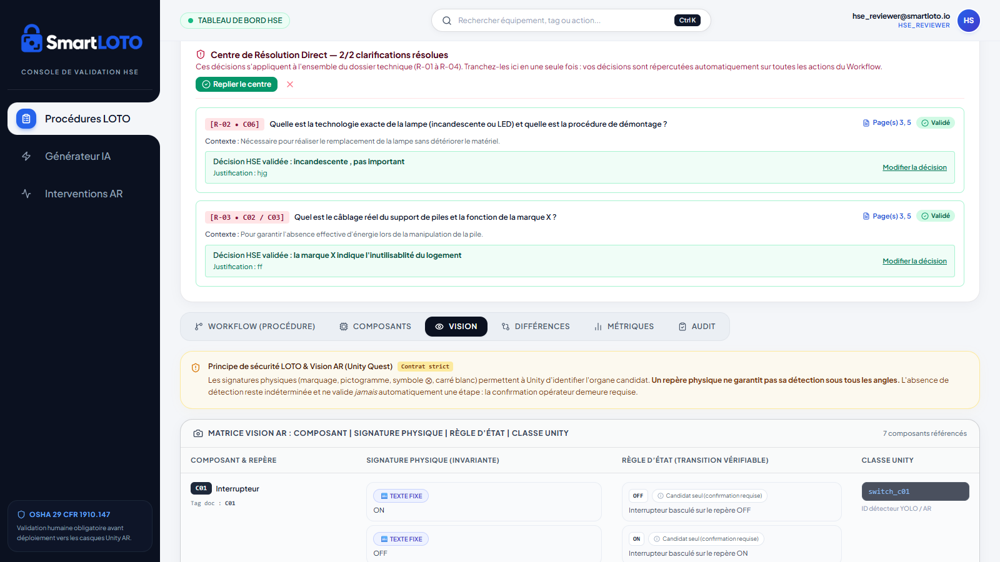
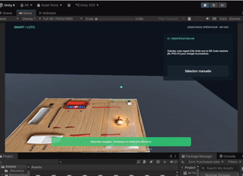

# SmartLOTO

**AI-Assisted Lockout/Tagout HSE Validation & AR Guidance System**


[](https://www.osha.gov/laws-regs/regulations/standardnumber/1910/1910.147)

## Overview

Industrial technical dossiers (PDF/P&ID) are processed into proposed LOTO steps, components and visual state rules.
The HSE console resolves ambiguities, verifies source citations and records formal reviewer sign-off before publication.
Unity executes a published, pinned procedure revision with visual checks, human confirmations and recorded evidence.
Closure produces a signed PDF audit report linked to that intervention and revision.

## System Architecture & Visuals



| HSE Dashboard & AI Procedure Generator | Direct Resolution Center & Vision Matrix | AR Execution & Signed Audit Report |
| --- | --- | --- |
|  |  |  |

Captures réelles de l'application et démonstration animée : Tableau de bord HSE, Centre de Résolution & Matrice Vision, et déroulement de l'intervention sous Unity 6 AR.
The [v0.3 technical dossier](apps/authoring-service/data/reference/SmartLOTO_SL-POC-01_Dossier_Technique_Descriptif_v0.3.pdf) and [synthetic demo sequence](apps/authoring-service/data/reference/SmartLOTO_sequence_A09_corrigee/LIRE_MOI.md) are included.

## Repository Structure

```text
SmartLOTO/
├── apps/
│   ├── authoring-service/       # PDF ingestion, AI extraction, HSE review & publication
│   │   ├── app/                # FastAPI routes, schemas, persistence and services
│   │   ├── data/reference/     # Official sample dossier and simulation assets
│   │   └── tests/              # Authoring and revision lifecycle checks
│   ├── field-service/          # Unity API, contextual vision and PDF audit reports
│   │   ├── app/
│   │   ├── storage/            # Runtime evidence, signatures and reports (ignored)
│   │   └── tests/
│   └── hse-dashboard/          # React/Vite HSE console and frontend tests
├── unity-app/                  # C# source bundle; integrate into an existing Unity project
│   └── Assets/                 # StreamingAssets contracts and editor utility
├── docs/                       # Architecture, contracts, setup notes and application captures
├── scripts/                    # Local API launchers, explicit demo reset and contract check
├── infra/                      # Historical container/schema configuration; see infra/README.md
├── data/                       # Local shared SQLite state (ignored)
├── .env.example                # Shared API configuration, without credentials
└── LAUNCH.md                   # Detailed setup, testing and headset configuration
```

## Quick Start (Setup & Run)

**Prerequisites:** Python 3.12+ (declared backend target), Node.js 20+, Git; Tesseract on `PATH` for scanned PDFs.
Run from the repository root in PowerShell. The commands preserve existing `.env` files.

```powershell
python -m venv .venv
.\.venv\Scripts\python.exe -m pip install -r apps/authoring-service/requirements.txt -r apps/field-service/requirements.txt
npm.cmd --prefix apps/hse-dashboard ci
if (-not (Test-Path .env)) { Copy-Item .env.example .env }
if (-not (Test-Path apps/hse-dashboard/.env)) { Copy-Item apps/hse-dashboard/.env.example apps/hse-dashboard/.env }
```

Set `GEMINI_API_KEY` and `GEMINI_MODEL` in the root `.env` to credentials/model access available to your account.
Keep `DOCUMENT_GENERATION_PROVIDER=gemini` and `FIELD_VISION_PROVIDER=gemini` for PDF analysis and contextual field checks.
The APIs can start without AI credentials; provider-dependent operations require them.

Start each service in a separate terminal, from the repository root:

```powershell
# Terminal 1 — Authoring API
.\.venv\Scripts\python.exe -m uvicorn main:app --app-dir apps/authoring-service --host 127.0.0.1 --port 8001
```

```powershell
# Terminal 2 — Field API (LAN binding for a headset)
.\.venv\Scripts\python.exe -m uvicorn main:app --app-dir apps/field-service --host 0.0.0.0 --port 8000
```

```powershell
# Terminal 3 — HSE console
npm.cmd --prefix apps/hse-dashboard run dev -- --host 127.0.0.1 --port 5173 --strictPort
```

Open the console at **http://localhost:5173**. API documentation: **http://127.0.0.1:8001/docs** and **http://127.0.0.1:8000/docs**.
Both APIs use `data/smartloto.db`; field artifacts remain under `/storage/evidence/`, `/storage/signatures/` and `/storage/reports/`.

**Unity / AR:** this repository contains client sources, not a complete Unity project or prebuilt APK.
Follow [Unity integration](docs/UNITY_INTEGRATION_READY.md), then launch your configured host project:

```powershell
$unityEditor = 'C:\Program Files\Unity\Hub\Editor\<installed-version>\Editor\Unity.exe'
$unityProject = 'C:\path\to\your\SmartLOTOUnityProject'
& $unityEditor -projectPath $unityProject
```

In Unity, set `SmartLOTOClient.backendUrl` to `http://127.0.0.1:8000` for desktop Play Mode or the server's LAN address for a headset. Use the same reachable address for `BASE_URL` in the API environment. Publish an HSE-approved revision before starting a field intervention.

See [detailed launch and tests](LAUNCH.md), [architecture](docs/ARCHITECTURE.md), [Unity API contracts](docs/unity_api_contracts.md) and [release scope](docs/RELEASE.md). The OSHA badge links the reference standard; it is not a certification of a generated procedure.
