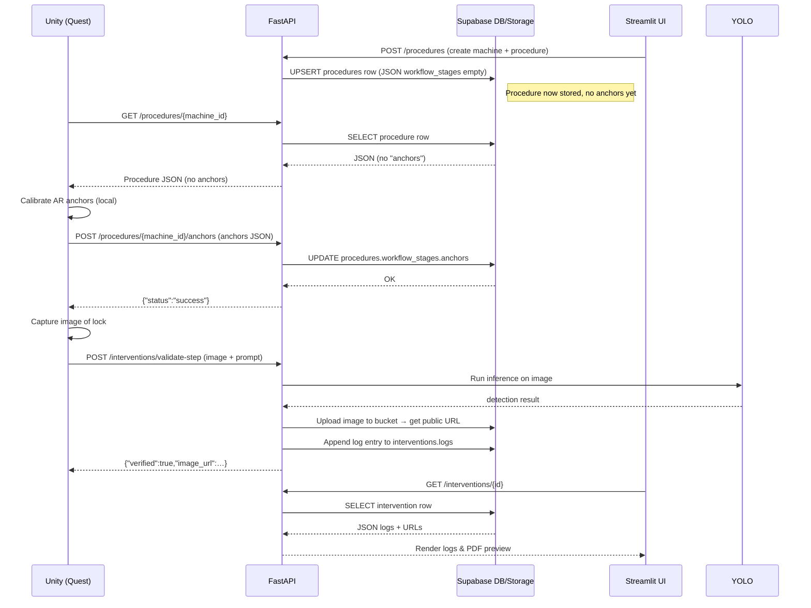

# SmartLOTO – Industrial Lock‑Out/Tag‑Out (LOTO) Assistance Platform

**A turnkey AR‑enabled safety‑checklist system that runs on Meta Quest 2/3, a FastAPI backend, Supabase storage, and a Streamlit dashboard.**

---

## 📚 Table of Contents

1. [Project Overview](#-project‑overview)
2. [High‑Level Architecture](#-high‑level‑architecture)
   - 2.1 [Component Diagram](#21‑component‑diagram)
   - 2.2 [Data‑Flow / Sequence Diagram](#22‑data‑flow‑sequence‑diagram)
3. [Repository Layout & Key Files](#-repository‑layout‑key‑files)
4. [Backend (FastAPI)](#-backend‑fastapi)
   - 4.1 [API Endpoints](#41‑api‑endpoints)
   - 4.2 [Supabase Integration](#42‑supabase‑integration)
5. [Unity Client (C#)](#-unity‑client‑c)
   - 5.1 [Network Layer](#51‑network‑layer)
   - 5.2 [Data Models & Serialization](#52‑data‑models‑serialization)
6. [Streamlit Dashboard (Python)](#-streamlit‑dashboard‑python)
7. [Ngrok (optional public tunnel)](#-ngrok-optional‑public‑tunnel)
8. [Local Network / Firewall Setup](#-local‑network‑firewall‑setup)
9. [Build & Deployment](#-build‑deployment)
   - 9.1 [Running Everything Locally](#91‑running‑everything‑locally)
   - 9.2 [Deploying to Meta Quest](#92‑deploying‑to‑meta‑quest)
10. [Testing & Debugging Tips](#-testing‑debugging‑tips)
11. [Future‑Proofing & Extensibility](#-future‑proofing‑extensibility)
12. [Appendix – Full File‑to‑Function Mapping](#-appendix‑full‑file‑to‑function‑mapping)

---

## 🚀 Project Overview

SmartLOTO is a **premium‑grade, OSHA‑1910.147‑compliant** workflow that helps field operators lock out hazardous equipment using a **mixed‑reality headset**.

* **AR Front‑End (Unity)** – Guides the operator step‑by‑step, captures camera images, uploads calibrated spatial anchors, and allows manual overrides.
* **FastAPI Backend** – Stores procedures, interventions, evidence images, and audit PDFs in Supabase; runs YOLO‑World for zero‑shot visual verification.
* **Supabase** – PostgreSQL for structured JSON data (`procedures`, `interventions`) + Object storage bucket (`smartloto‑assets`) for binary assets (photos, signatures, PDFs).
* **Streamlit Dashboard** – Allows safety managers to create/edit procedures, view live logs, generate PDF audit reports, and manage anchors.

All components communicate over **HTTPS** (or plain HTTP on a local LAN for demo) via **RESTful JSON** payloads.

---

## 🏗️ High‑Level Architecture

```mermaid
graph LR
    subgraph Quest[Meta Quest (AR headset)]
        Unity[SmartLOTOClient.cs] -->|HTTPS (JSON + Base64 images)| Backend
        Unity -->|GET procedure JSON| Backend
    end

    subgraph Server[Backend Server (FastAPI)]
        Backend[backend.py] -->|Supabase client| SupabaseDB[(Supabase PostgreSQL)]
        Backend -->|Supabase Storage| SupabaseBucket[(smartloto‑assets bucket)]
        Backend -->|YOLO‑World model| YOLO[YOLO‑World (local file yolov8s‑worldv2.pt)]
    end

    subgraph Dashboard[Streamlit Dashboard (app.py)]
        Dashboard -->|REST calls| Backend
        Dashboard -->|Supabase direct read| SupabaseDB
        Dashboard -->|Supabase storage browse| SupabaseBucket
    end

    subgraph Tunnel[Optional Ngrok Tunnel]
        Ngrok[ngrok] -->|HTTPS public URL| Backend
    end

    style Quest fill:#E0F7FA,stroke:#006064
    style Server fill:#FFF3E0,stroke:#E65100
    style Dashboard fill:#F3E5F5,stroke:#4A148C
    style Tunnel fill:#E8F5E9,stroke:#1B5E20
```

### 2.1 Component Diagram

| Component | Language / Runtime | Primary Responsibilities |
|-----------|--------------------|---------------------------|
| **Unity (`unity‑app/`)** | C# (Unity 2022+) | UI, AR anchor capture, image capture, HTTP client, JSON↔C# serialization |
| **FastAPI (`backend.py`)** | Python 3.11 | REST API, YOLO‑World inference, Supabase CRUD, PDF generation |
| **Supabase** | PostgreSQL 15 + Object Storage | Persistent JSON tables (`procedures`, `interventions`), file bucket (`smartloto‑assets`) |
| **Streamlit (`app.py`)** | Python 3.11 | Procedure authoring UI, logs viewer, PDF preview, manual anchor upload |
| **Ngrok** (optional) | External service | Exposes local port 8000 via secure HTTPS tunnel for remote demos |
| **Firewall** | Windows built‑in | Allows inbound TCP 8000 from LAN devices (Quest headset) |

### 2.2 Data‑Flow / Sequence Diagram



---

## 📁 Repository Layout & Key Files

```
LOTO_PROJECT/
│
├─ backend.py                 # FastAPI server, all API routes
├─ app.py                     # Streamlit dashboard
├─ .env                       # Supabase credentials (SUPABASE_URL, SUPABASE_KEY)
│
├─ unity-app/
│   ├─ SmartLOTOClient.cs          # Core HTTP client, coroutines
│   ├─ AnchorItem.cs                # Serializable struct (organ_name + pose)
│   ├─ AnchorsUpdate.cs             # Wrapper for JsonUtility (list → dict)
│   ├─ LOTOConfig.cs   (optional)  # Holds `backendUrl` as ScriptableObject
│   └─ Editor/
│        └─ LOTOMenu.cs             # Quick‑menu for opening dashboard / IP copy
│
└─ assets/ (optional)
```

| File | Purpose | Clickable link |
|------|---------|----------------|
| `backend.py` | FastAPI service, endpoint definitions, Supabase client, YOLO inference, PDF generation | [backend.py](file:///c:/Users/Lenovo/Desktop/LOTO_PROJECT/backend.py) |
| `app.py` | Streamlit UI for creating machines, uploading anchors, viewing logs, generating PDFs | [app.py](file:///c:/Users/Lenovo/Desktop/LOTO_PROJECT/app.py) |
| `SmartLOTOClient.cs` | Unity side networking (POST/GET), adds `ngrok‑skip‑browser‑warning` header, parses JSON responses | [SmartLOTOClient.cs](file:///c:/Users/Lenovo/Desktop/LOTO_PROJECT/unity-app/SmartLOTOClient.cs) |
| `AnchorItem.cs` | POCO model: `organ_name` + 6 pose floats – the smallest unit Unity sends | [AnchorItem.cs](file:///c:/Users/Lenovo/Desktop/LOTO_PROJECT/unity-app/AnchorItem.cs) |
| `AnchorsUpdate.cs` | Wrapper containing `AnchorItem[] anchors_list` – required because `JsonUtility` cannot serialize dictionaries directly | [AnchorsUpdate.cs](file:///c:/Users/Lenovo/Desktop/LOTO_PROJECT/unity-app/AnchorsUpdate.cs) |
| `LOTOConfig.cs` (optional) | Exposes `backendUrl` as a ScriptableObject so designers can change IP without recompilation | [LOTOConfig.cs](file:///c:/Users/Lenovo/Desktop/LOTO_PROJECT/unity-app/LOTOConfig.cs) |
| `LOTOMenu.cs` | Adds a Unity Editor “SmartLOTO” menu → copy IP to clipboard, open Streamlit dashboard | [LOTOMenu.cs](file:///c:/Users/Lenovo/Desktop/LOTO_PROJECT/unity-app/Editor/LOTOMenu.cs) |

> **IMPORTANT** – All network‑related constants (`backendUrl`, API paths) live in `SmartLOTOClient.cs` (or `LOTOConfig.cs`). Update them **once** and every component will follow.

---

## 🖥️ Backend (FastAPI)

### 4.1 API Endpoints

| Method | Path | Body / Query | Returns | What it does |
|--------|------|--------------|---------|--------------|
| `GET` | `/` | – | `{status, service, timestamp}` | Health‑check |
| `GET` | `/procedures/{machine_id}` | – | Procedure JSON (incl. `workflow_stages`) | Retrieve a complete procedure for a machine |
| `POST` | `/procedures/{machine_id}/anchors` | `AnchorsUpdate` (list of `AnchorItem`) | `{status:"success", message}` | Insert/replace the `"anchors"` object inside `workflow_stages` |
| `POST` | `/interventions/start` | `StartIntervention` (`machine_id`, `operator_name`) | `{status:"success", intervention}` | Create a new `interventions` row (`IN_PROGRESS`) |
| `POST` | `/interventions/validate-step` | `ActionValidation` (image + prompt) | `{verified, message, image_url}` | Run YOLO‑World detection, store evidence image, append log |
| `POST` | `/interventions/override-step` | `ActionOverride` (image + reason) | `{verified:true, message, image_url}` | Manual override with evidence, append log |
| `POST` | `/interventions/close` | `CloseIntervention` (signature) | `{status:"success", pdf_report_url}` | Generate PDF audit, upload to storage, mark `COMPLETED` |
| `GET` | `/interventions/{id}` | – | Full intervention JSON (including `logs`) | Dashboard uses this to show live step history |

> All routes **require** the Supabase client (`db`) to be initialized. If `db` is `None` (missing `.env`), an HTTP 500 is raised.

### 4.2 Supabase Integration

* **Tables (JSON‑B)**
  - `procedures` – columns: `machine_id (PK)`, `machine_name`, `status`, `workflow_stages` (JSON). 
  - `interventions` – columns: `id (PK)`, `machine_id`, `operator_name`, `status`, `logs` (JSON array), `signature_url`, `pdf_report_url`, timestamps. 

* **Storage Bucket** – `smartloto‑assets`
  - Paths: `evidence/…jpg`, `signatures/…png`, `reports/…pdf`. 
  - The bucket is **publicly readable** (required for the Quest to fetch images). 

* **Helper functions** (in `backend.py`)
  - `decode_base64_image()` – converts a base64 string → OpenCV `numpy` array + raw bytes. 
  - `upload_to_supabase_storage()` – thin wrapper around `db.storage.from_(bucket).upload()`. 

---

## 🎮 Unity Client (C#)

### 5.1 Network Layer

All HTTP interactions are funneled through `SmartLOTOClient.cs`. Key methods (coroutine pattern) :

| Method | Endpoint | Payload | Response handling |
|--------|----------|---------|-------------------|
| `GetProcedure(string machineId)` | `GET /procedures/{machineId}` | – | Deserialises JSON into `ProcedureResponse` (contains `workflow_stages`). |
| `UploadCalibratedAnchors(string machineId, List<AnchorItem> anchors)` | `POST /procedures/{machineId}/anchors` | `AnchorsUpdate` (list) | Checks `status=="success"` and logs outcome. |
| `StartIntervention(string machineId, string operatorName)` | `POST /interventions/start` | `StartIntervention` | Stores `interventionId` locally. |
| `ValidateStep(ActionValidation data)` | `POST /interventions/validate-step` | Image (Base64) + vision prompt | Shows success/failure UI, stores proof image URL. |
| `ManualOverride(ActionOverride data)` | `POST /interventions/override-step` | Image (Base64) + reason | Same UI flow as validation but forces success. |
| `CloseIntervention(CloseIntervention data)` | `POST /interventions/close` | Signature (Base64) | Retrieves generated PDF URL for final audit view |

All requests add the header:

```csharp
request.Headers.Add("ngrok-skip-browser-warning", "true");
```

> **Why?** When you run the backend behind an ngrok tunnel the first request returns an HTML landing page. The header forces ngrok to skip that page, ensuring you always receive a clean JSON response.

### 5.2 Data Models & Serialization

* **`AnchorItem`** – `[Serializable]` struct with `organ_name` + 6 floats. 
* **`AnchorsUpdate`** – wrapper class required because Unity’s `JsonUtility` can only serialize *arrays* or *objects*, **not** dictionaries. The backend converts this list back into a dictionary (`anchors_dict`). 

**Tip:** Keep the C# models **exactly** in sync with the Pydantic models in `backend.py` (`AnchorItem`, `AnchorsUpdate`). If you add a field, update both sides.

---

## 📊 Streamlit Dashboard (Python)

* **Entry point:** `app.py`. 
* **Key UI sections:**
  1. **Create / Edit Machine** – writes to `procedures` (via Supabase `upsert`). 
  2. **Upload Anchors** – reads a local JSON file (format `{"anchors_list":[...]}`) and POSTs to the backend (`/procedures/{machine_id}/anchors`). 
  3. **Live Intervention Log** – polls `/interventions/{id}` and renders a table with timestamps, step, type, and result. 
  4. **Generate / Download PDF** – calls `/interventions/close` (or uses the already‑generated URL). 

* **Supabase Direct Access** – for quick editing of procedures, the dashboard can also call `supabase.table("procedures").select("*")` directly without going through FastAPI.

---

## 🌐 Ngrok (Optional Public Tunnel)

| What you get | How to enable |
|--------------|---------------|
| A **public HTTPS URL** (`https://xxxxx.ngrok-free.dev`) that forwards to your local machine’s port 8000. | 1. Run `ngrok http 8000` (or the packaged script you used). 2. Copy the forwarding URL. 3. Set `backendUrl = "https://xxxxx.ngrok-free.dev"` in Unity (or `LOTOConfig`). |
| Automatic HTTPS & firewall bypass for remote demo. | The `ngrok‑skip‑browser‑warning` header must stay in your Unity client; otherwise the first request will receive ngrok’s landing HTML. |

> **Caution** – Ngrok’s free tier rotates URLs on each start. Save the URL in `LOTOConfig.cs` after each launch if you need a stable endpoint for a demo.

---

## 🔐 Local Network / Firewall Setup 

### Step‑by‑step (run **once**)

```powershell
# 1️⃣ Find your PC’s LAN IP (e.g. 192.168.1.42)
Get-NetIPAddress -AddressFamily IPv4 | Where-Object {$_.InterfaceAlias -like "*Wi‑Fi*"}

# 2️⃣ Open inbound TCP port 8000 for the whole private subnet
New-NetFirewallRule `
    -DisplayName "SmartLOTO Backend – LAN only" `
    -Direction Inbound `
    -Protocol TCP `
    -LocalPort 8000 `
    -RemoteAddress 192.168.1.0/24 `
    -Action Allow `
    -Profile Private `
    -Enabled True
```

* **Why Private profile only?** The rule is ignored when you connect to a public Wi‑Fi, reducing exposure. 
* **Disable later** – `Set-NetFirewallRule -DisplayName "SmartLOTO Backend – LAN only" -Enabled False`

### Verify 

```powershell
Test‑NetConnection -ComputerName 192.168.1.42 -Port 8000
```
You should see `TcpTestSucceeded : True`.

---

## 📦 Build & Deployment 

### 9.1 Running Everything Locally 

```bash
# 0️⃣ Clone the repo and cd into it
git clone <repo‑url>
cd LOTO_PROJECT

# 1️⃣ Install Python deps (use uv if installed)
uv pip install -r requirements.txt   # or pip install -r requirements.txt

# 2️⃣ Load env variables (Supabase credentials)
copy .env.example .env   # fill in SUPABASE_URL and SUPABASE_KEY

# 3️⃣ Start FastAPI backend
uvicorn backend:app --host 0.0.0.0 --port 8000

# 4️⃣ In a new terminal, launch Streamlit dashboard
streamlit run app.py

# 5️⃣ Open Unity, set `backendUrl` to your PC’s LAN IP, press Play.
#    (If you’re using ngrok, set the URL instead.)
```
*All three processes (backend, dashboard, Unity) can run simultaneously on the same machine.*

### 9.2 Deploying to Meta Quest 

1. **Open “Build Settings” → Android** (target platform). 
2. **Player Settings → Other Settings → Internet Access = “Require”** (so the headset may reach your PC). 
3. **Scripting Backend = IL2CPP** (default for Quest). 
4. **Build → APK / AAB** → transfer to the headset via `adb install`. 

When you start the app on the Quest, it will try to contact `backendUrl`. 
*If you are on the same Wi‑Fi network and have the firewall rule enabled, use the **LAN IP** (e.g., `http://192.168.1.42:8000`).* 

> **NOTE** – The Quest runs Android, so `localhost` refers to the Android VM, **not** your PC. That’s why the IP configuration is mandatory.

---

## 🧪 Testing & Debugging Tips 

| Issue | Quick Debug |
|-------|--------------|
| **No response from backend** | Check firewall (`Get-NetFirewallRule`), verify that `uvicorn` is listening on `0.0.0.0:8000`, ping the IP from the Quest (use `adb shell ping <IP>`). |
| **HTML landing page instead of JSON** | Ensure the `ngrok‑skip‑browser‑warning` header is present in every Unity request, or disable ngrok and use direct LAN IP. |
| **YOLO‑World model not loading** | Verify `yolov8s-worldv2.pt` exists in the working directory, and that the Python process has permission to read it. |
| **Images not appearing in dashboard** | Confirm that the bucket `smartloto‑assets` is set to **public**; otherwise the generated URLs will be signed‑private and the dashboard can’t fetch them. |
| **Anchors never show up** | Make sure you called `UploadCalibratedAnchors()` **after** the procedure exists; the endpoint will return `404` if the machine id is not found. |

Use the **Streamlit logs** (`streamlit run app.py`) and **FastAPI logs** (stdout of `uvicorn`) to see JSON payloads.

---

## 🔮 Future‑Proofing & Extensibility 

* **Authentication** – Add JWT middleware to FastAPI; Unity can store a token in `PlayerPrefs`. 
* **Versioned Procedures** – Store a `version` field in `procedures`; every update creates a new row while preserving history. 
* **Additional Sensors** – Extend `ActionValidation` with a field for depth data or point‑clouds. 
* **Multi‑Site Support** – Prefix Supabase bucket paths with `<site_id>/` to isolate assets per plant. 
* **CI/CD** – Containerize the backend (`Dockerfile`) and push to a cloud provider (e.g., Railway) for production; keep the same API contract. 

---

## 📎 Appendix – Full File‑to‑Function Mapping 

| File | Primary Functions / Endpoints | Description |
|------|------------------------------|-------------|
| `backend.py` | `read_root`, `get_procedure`, `start_intervention`, `validate_step`, `override_step`, `close_intervention`, `update_procedure_anchors` | FastAPI router, Supabase CRUD, YOLO inference, PDF generation. |
| `app.py` | `create_machine`, `edit_machine`, `upload_anchors`, `view_intervention_logs`, `download_report` | Streamlit UI, direct Supabase calls, optional POST to backend for anchors. |
| `unity-app/SmartLOTOClient.cs` | `GetProcedure()`, `UploadCalibratedAnchors()`, `StartIntervention()`, `ValidateStep()`, `ManualOverride()`, `CloseIntervention()` | Unity coroutines, HTTPClient, JSON serialization, header injection. |
| `unity-app/AnchorItem.cs` | Serializable struct for a single anchor point. |
| `unity-app/AnchorsUpdate.cs` | Wrapper class (`public AnchorItem[] anchors_list;`) needed for `JsonUtility`. |
| `unity-app/LOTOConfig.cs` (optional) | `public static string BackendUrl = "http://192.168.x.x:8000";` – editable in the inspector. |
| `unity-app/Editor/LOTOMenu.cs` | Adds a Unity editor menu: *SmartLOTO → Copy Backend URL*; opens dashboard in default browser. |
| `.env` | Holds `SUPABASE_URL` and `SUPABASE_KEY`. Must be present before starting the backend. |
| `requirements.txt` | Python dependencies: `fastapi`, `uvicorn`, `supabase`, `opencv-python`, `ultralytics`, `reportlab`, `python‑dotenv`, `pydantic`. |
| `yolov8s-worldv2.pt` | YOLO‑World model file (≈ 35 MB). Must reside beside `backend.py` or be referenced by absolute path. |

---

### 🎉 You’re ready!

- **Create a machine** in the Streamlit dashboard → you now have a row in `procedures`. 
- **Calibrate anchors** on the Quest → `UploadCalibratedAnchors()` will populate the `"anchors"` key. 
- **Run interventions** – each step automatically logs images, detection results, and manual overrides. 
- **Close the intervention** → a PDF audit report is generated, stored in Supabase, and linked back to the dashboard. 

All data flows are documented above; follow the diagrams and the file‑to‑function table to locate any piece of the system instantly.

> **⚡️ Pro tip:** Keep the `ngrok‑skip‑browser‑warning` header in place even when you switch back to LAN IP – it costs nothing and future‑proofs you for the next remote demo.

Happy locking out! 🚧🔒
