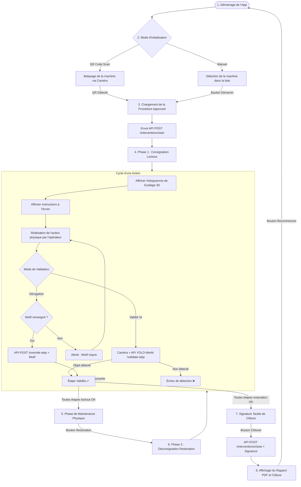

# Spécification et Workflow de l'Application AR (Unity) — SmartLOTO

Ce document détaille l'architecture des écrans (Panels), le déroulement logique (Workflow) et le système de guidage holographique de l'application Unity. Il sert de base de référence pour uniformiser l'interface et lui appliquer un thème visuel cohérent.

---

## 1. Architecture des Écrans (Panels UI)

L'interface utilisateur de l'application Unity est structurée autour de **7 panneaux principaux** activés sélectivement par le script `LotoUIController.cs` :

| Nom du Panneau (`GameObject`) | Rôle & Composants Principaux |
| :--- | :--- |
| **`welcomePanel`** | **Écran d'Accueil** : Choix du mode d'initialisation de l'intervention. • Bouton `chooseQRScanButton` (Scanner QR Code) • Bouton `chooseManualButton` (Sélection Manuelle) |
| **`qrScanPanel`** | **Scanner QR Code** : Initialisation rapide en filmant le QR Code de la machine. • Flux vidéo de la caméra (`RawImage` + `LotoQRScanner` avec bibliothèque ZXing) • Bouton Retour `qrBackButton` • Ligne laser animée de balayage `scanLaserLine` |
| **`manualSelectionPanel`** | **Sélection Manuelle** : Choix de la machine dans une liste déroulante si le scan n'est pas possible. • Menu déroulant `machineIdDropdown` • Bouton de démarrage `startButton` • Bouton Retour `manualBackButton` |
| **`stepPanel`** | **Console d'Exécution des Étapes** : Écran central guidant l'opérateur dans la consignation ou déconsignation. • Phase en cours `phaseTitleText` (Consignation / Déconsignation) • Titre de l'étape `stageTitleText` et description de l'action `stepDescText` • Consigne pour l'IA `visionPromptText` (ex: *cadenas rouge*, *disjoncteur*) • Retour caméra en temps réel `cameraPreviewImage` • Zone de texte pour le motif `overrideReasonInput` • Bouton de détection IA `validateButton` • Bouton de forçage manuel `overrideButton` |
| **`maintenancePanel`** | **Écran de Maintenance** : Transition invitant l'opérateur à réaliser ses réparations physiques une fois la machine consignée. • Message d'instruction • Bouton `startRestorationButton` (Débuter la Déconsignation) |
| **`signaturePanel`** | **Écran de Signature** : Validation de la fin de l'intervention par signature tactile. • Zone de dessin/signature `signatureCanvas` • Bouton `submitSignatureButton` (Clôturer l'intervention) |
| **`reportPanel`** | **Écran du Rapport** : Clôture avec accès au fichier d'audit. • Zone d'affichage de l'URL `reportUrlText` • Bouton `openReportButton` (Ouvrir le PDF dans le navigateur) • Bouton `restartButton` (Retour à l'accueil) |

---

## 2. Déroulement du Workflow (Cycle de Vie)

Le diagramme ci-dessous décrit le workflow complet de l'application, de l'accueil jusqu'à la génération du rapport final :

---

## 3. Système de Guidage Holographique 3D

Pour aider visuellement l'opérateur en Réalité Mixte, le script `LotoHologramGuide.cs` génère un pointeur 3D dynamique :

1. **Calcul de Position (`LotoManager.cs`)** :
   * Le manager recherche un GameObject racine nommé `LOTO_Origin_Anchor` dans la scène Unity (qui sert d'origine spatiale calibrée via les ancres de la machine).
   * Pour chaque étape, il vérifie si la description ou l'invite visuelle correspond à un organe de la machine dont la position 3D est connue.
   * Il instancie un hologramme à la position correspondante relative à l'ancre d'origine.
2. **Forme Visuelle (`LotoHologramGuide.cs`)** :
   * L'hologramme est construit dynamiquement à l'aide de primitives géométriques : un **cylindre** (tige de la flèche) pointant vers le bas, surmonté d'une **sphère** (tête du pointeur).
   * Un shader transparent coloré (vert transparent par défaut) lui est appliqué pour lui donner un aspect de "projection holographique".
3. **Animations intégrées** :
   * **Rebond (Bouncing)** : La hauteur locale du pointeur oscille continuellement suivant une onde sinusoïdale (`Mathf.Sin(Time.time * bounceSpeed)`) pour attirer le regard.
   * **Rotation** : Le pointeur tourne sur son axe vertical à une vitesse constante (`Space.World`).

---

## 4. Charte Graphique Actuelle & Thème (UI System)

Le script `LotoUIController.cs` embarque une palette de couleurs premium pour piloter les retours utilisateur et les statuts système :

* **Gris Premium (`PremiumGray`)** : `#708097` — Écrans d'attente, états inactifs, neutres.
* **Vert Premium (`PremiumGreen`)** : `#2EC473` — Succès, étapes validées, fin de procédure.
* **Rouge Premium (`PremiumRed`)** : `#E64747` — Alertes, erreurs de détection, saisie manquante.
* **Bleu Premium (`PremiumBlue`)** : `#1E6EDB` — Notifications d'information, consignes de recherche.
* **Jaune/Ambre Premium (`PremiumYellow`)** : `#F29C12` — Attente de traitement API, traitements YOLO-World.

### Suggestions pour l'application d'un Thème Cohérent

Pour aligner l'application Unity avec le thème Streamlit (`config.toml` : `#1A365D` pour le bleu foncé primaire, `#2D3748` pour le texte foncé), nous pouvons :
1. **Remplacer `PremiumBlue`** par le bleu marine du thème : `new Color(0.10f, 0.21f, 0.36f)` (`#1A365D`).
2. **Utiliser une police géométrique moderne** (ex: *Outfit* ou *Inter*) sur tous les composants TextMeshPro de Unity.
3. **Ajouter un effet de Glassmorphism** (panneaux semi-transparents avec flou d'arrière-plan) pour renforcer l'esthétique premium de la réalité mixte.
4. **Donner à l'hologramme de guidage 3D** une couleur néon cyan/bleue vibrante assortie plutôt que le vert de base.
